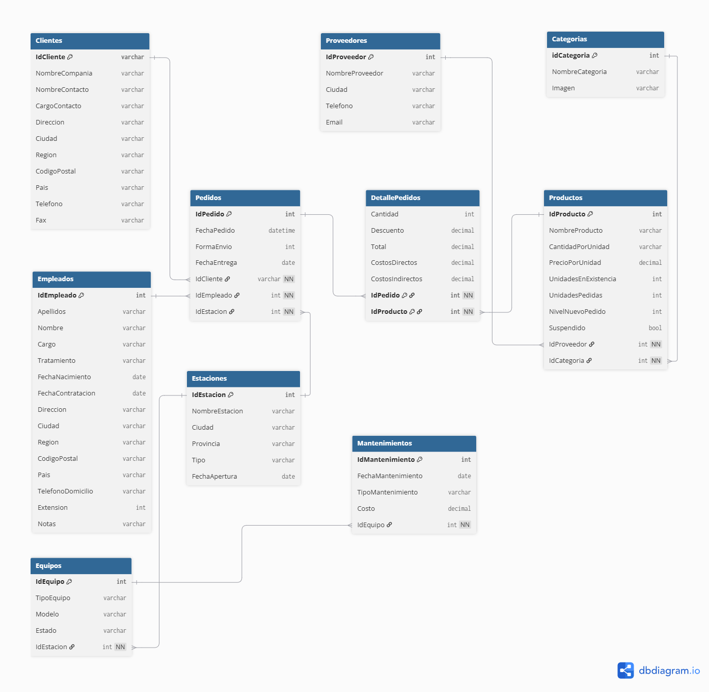

# PROYECTO DATAFUEL S.A. — DOCUMENTACIÓN FUNCIONAL

* **Versión:** 1.0
* **Proyecto:** DATAFUEL S.A. – Data Warehouse para la enseñanza de SQL, Power BI y Data Analytics
* **Autores (Grupo 5):**
  * Luciana Selene Agüero Lucero
  * Vanina Candelaria Sulca
  * Germán M. Zepeda
* **Fecha:** Septiembre 2026

---

## 1. Introducción
DATAFUEL S.A. es una empresa ficticia del sector energético creada con fines educativos para la enseñanza de herramientas de análisis de datos, modelado de bases de datos, SQL y Power BI.

La empresa se dedica a la comercialización de combustibles, lubricantes, insumos industriales y servicios técnicos, operando una red de estaciones de servicio y centros logísticos distribuidos en distintas regiones.

El objetivo del Data Warehouse es representar un escenario empresarial realista que permita desarrollar ejercicios de limpieza y transformación de datos, consultas SQL, modelado dimensional, análisis de indicadores y construcción de dashboards en Power BI.

---

## 2. Objetivos del Data Warehouse
El modelo fue diseñado para permitir el desarrollo de actividades relacionadas con:
* Modelado de datos
* Consultas SQL
* Power Query (Lenguaje M)
* Modelado en Power BI
* Creación de medidas DAX
* Limpieza y transformación de datos
* Análisis exploratorio
* Construcción de indicadores (KPIs)
* Visualización de información
* Análisis geográfico

---

## 3. Modelo de Negocio
DATAFUEL S.A. comercializa productos destinados al sector energético, abasteciendo tanto a clientes corporativos como a organizaciones públicas y privadas.

La empresa administra un catálogo de productos organizado por categorías, registra pedidos realizados por sus clientes y gestiona las operaciones comerciales a través de su equipo de ventas.

Además del proceso comercial, la organización controla sus activos físicos mediante estaciones de servicio, equipos industriales y planes de mantenimiento, integrando toda la información en un único Data Warehouse.

---

## 4. Modelo de Datos
El Data Warehouse de DATAFUEL S.A. está compuesto por dos Data Marts que representan los principales procesos de negocio de la organización:

| Data Mart | Objetivo | Tablas |
| :--- | :--- | :--- |
| **Data Mart Comercial** | Gestiona las operaciones de venta y comercialización de productos. | Categorías, Productos, Clientes, Empleados, Pedidos y Detalle de Pedidos. |
| **Data Mart de Infraestructura y Operaciones** | Gestiona los activos físicos de la empresa y el mantenimiento de las estaciones de servicio. | Proveedores, Estaciones, Equipos y Mantenimiento. |

---

## 5. Diccionario de Datos

### 5.1 Tabla: Categorías
Clasifica los productos comercializados por DATAFUEL S.A. en diferentes grupos para facilitar la gestión comercial, el control del inventario y el análisis de ventas.

**Información General:**
| Propiedad | Valor |
| :--- | :--- |
| Tipo de tabla | Dimensión |
| Clave primaria | `IdCategoria` |
| Cantidad de registros | 8 |
| Relación | Productos |

**Campos:**
| Campo | Tipo | Descripción |
| :--- | :--- | :--- |
| `IdCategoria` | Entero | Identificador único de la categoría. |
| `NombreCategoria` | Texto | Nombre de la categoría del producto. |
| `Imagen` | Texto | URL de la imagen representativa de la categoría. |

**Reglas de negocio:**
* Cada producto pertenece a una única categoría.
* Una categoría puede contener múltiples productos.
* Las categorías forman parte del catálogo maestro y presentan baja frecuencia de actualización.

---

### 5.2 Tabla: Productos
Contiene el catálogo de productos comercializados por DATAFUEL S.A., incluyendo información relacionada con proveedores, categorías, precios e inventario.

**Información General:**
| Propiedad | Valor |
| :--- | :--- |
| Tipo de tabla | Dimensión |
| Clave primaria | `IdProducto` |
| Relaciones | Categorías, Proveedores, DetallePedidos |

**Campos:**
| Campo | Tipo | Descripción |
| :--- | :--- | :--- |
| `IdProducto` | Entero | Identificador único del producto. |
| `NombreProducto` | Texto | Nombre comercial del producto. |
| `IdProveedor` | Entero | Proveedor principal del producto. |
| `IdCategoria` | Entero | Categoría a la que pertenece el producto. |
| `CantidadPorUnidad` | Texto | Presentación comercial (formatos y unidades de medida). |
| `PrecioPorUnidad` | Decimal / Moneda | Precio unitario del producto. |
| `UnidadesEnExistencia` | Entero | Stock disponible en almacén. |
| `UnidadesPedidas` | Entero | Cantidad comprometida en pedidos en curso. |
| `NivelNuevoPedido` | Entero | Punto de reposición del producto. |
| `Suspendido` | Booleano | Indica si el producto continúa comercializándose. |

**Reglas de negocio:**
* Cada producto pertenece a un único proveedor y a una única categoría.
* Los productos suspendidos permanecen en el catálogo histórico de ventas para preservar la integridad referencial.

---

### 5.3 Tabla: Clientes
Almacena la información de los clientes corporativos de DATAFUEL S.A., incluyendo datos de contacto y ubicación geográfica para análisis comercial.

**Información General:**
| Propiedad | Valor |
| :--- | :--- |
| Tipo de tabla | Dimensión |
| Clave primaria | `IdCliente` |
| Relaciones | Pedidos |

**Campos:**
| Campo | Tipo | Descripción |
| :--- | :--- | :--- |
| `IdCliente` | Texto | Identificador alfanumérico único del cliente. |
| `NombreCompania` | Texto | Razón social del cliente. |
| `NombreContacto` | Texto | Persona de contacto principal. |
| `CargoContacto` | Texto | Cargo del contacto en su empresa. |
| `Direccion` | Texto | Dirección fiscal o comercial. |
| `Ciudad` | Texto | Ciudad sede. |
| `Region` | Texto | Provincia, estado o región (admite nulos). |
| `CodigoPostal` | Texto | Código postal. |
| `Pais` | Texto | País sede. |
| `Telefono` | Texto | Teléfono principal. |
| `Fax` | Texto | Número de fax (admite nulos). |

**Reglas de negocio:**
* Un cliente puede realizar múltiples pedidos a lo largo del tiempo.
* Permite análisis de segmentación territorial por país, región y ciudad.

---

### 5.4 Tabla: Empleados
Contiene la información del personal de DATAFUEL S.A., incluyendo datos personales, demográficos y laborales.

**Información General:**
| Propiedad | Valor |
| :--- | :--- |
| Tipo de tabla | Dimensión |
| Clave primaria | `IdEmpleado` |
| Relaciones | Pedidos |

**Campos:**
| Campo | Tipo | Descripción |
| :--- | :--- | :--- |
| `IdEmpleado` | Entero | Identificador único del colaborador. |
| `Apellidos` | Texto | Apellidos del colaborador. |
| `Nombre` | Texto | Nombres del colaborador. |
| `Cargo` | Texto | Puesto desempeñado en la organización. |
| `Tratamiento` | Texto | Tratamiento formal de cortesía. |
| `FechaNacimiento` | Fecha | Fecha de nacimiento (permite cálculo etario). |
| `FechaContratacion` | Fecha | Fecha de ingreso (permite cálculo de antigüedad). |
| `Direccion` | Texto | Dirección de residencia. |
| `Ciudad` | Texto | Ciudad de residencia. |
| `Region` | Texto | Provincia o región de residencia. |
| `CodigoPostal` | Texto | Código postal. |
| `Pais` | Texto | País de residencia. |
| `TelefonoDomicilio` | Texto | Teléfono de contacto personal. |
| `Extension` | Entero | Número de interno telefónico corporativo. |
| `Notas` | Texto | Perfil profesional y trayectoria interna. |

**Reglas de negocio:**
* Un colaborador comercial puede gestionar múltiples pedidos.
* Las fechas de contratación y nacimiento son la base para indicadores demográficos de Recursos Humanos.

---

### 5.5 Tabla: Pedidos
Registra las cabeceras de transacciones comerciales, vinculando clientes, colaboradores responsables y tiempos logísticos.

**Información General:**
| Propiedad | Valor |
| :--- | :--- |
| Tipo de tabla | Hechos (Cabecera) |
| Clave primaria | `IdPedido` |
| Relaciones | Clientes, Empleados, DetallePedidos |

**Campos:**
| Campo | Tipo | Descripción |
| :--- | :--- | :--- |
| `IdPedido` | Entero | Identificador único de la transacción. |
| `IdCliente` | Texto | Cliente que emite el pedido. |
| `IdEmpleado` | Entero | Vendedor responsable del pedido. |
| `FechaPedido` | Fecha / Hora | Fecha y hora de emisión de la orden. |
| `FormaEnvio` | Entero | Código de la modalidad logística de envío. |
| `FechaEntrega` | Fecha | Fecha prevista o efectiva de recepción. |

**Reglas de negocio:**
* Cada pedido es gestionado por un único empleado.
* La granularidad a nivel producto se resuelve en la tabla de detalle.

---

### 5.6 Tabla: Detalle de Pedidos
Contiene la granularidad de línea de producto por orden comercial, registrando volúmenes, descuentos aplicados y estructura de costos.

**Información General:**
| Propiedad | Valor |
| :--- | :--- |
| Tipo de tabla | Hechos (Líneas transaccionales) |
| Clave primaria | Compuesta (`IdPedido`, `IdProducto`) |
| Relaciones | Pedidos, Productos |

**Campos:**
| Campo | Tipo | Descripción |
| :--- | :--- | :--- |
| `IdPedido` | Entero | Orden comercial asociada. |
| `IdProducto` | Entero | Producto comercializado. |
| `Cantidad` | Entero | Unidades vendidas. |
| `Descuento` | Decimal (Porcentaje) | Tasa de descuento aplicada sobre la línea. |
| `Total` | Decimal / Moneda | Importe facturado neto. |
| `CostosDirectos` | Decimal / Moneda | Costo directo imputado al lote. |
| `CostosIndirectos` | Decimal / Moneda | Costos operativos indirectos prorrateados. |

**Reglas de negocio:**
* Un pedido puede contener uno o más productos.
* Los costos directos e indirectos son la base para el margen de contribución y rentabilidad operativa.

---

### 5.7 Tabla: Proveedores
Almacena los proveedores estratégicos de insumos, repuestos y combustibles.

**Información General:**
| Propiedad | Valor |
| :--- | :--- |
| Tipo de tabla | Dimensión |
| Clave primaria | `IdProveedor` |
| Cantidad de registros | 10 |
| Relaciones | Productos |

**Campos:**
| Campo | Tipo | Descripción |
| :--- | :--- | :--- |
| `IdProveedor` | Entero | Identificador único del proveedor. |
| `NombreProveedor` | Texto | Razón social o denominación comercial. |
| `Ciudad` | Texto | Ciudad de radicación. |
| `Telefono` | Texto | Teléfono de contacto comercial. |
| `Email` | Texto | Correo electrónico institucional. |

---

### 5.8 Tabla: Estaciones
Contiene la red de estaciones de servicio administradas por DATAFUEL S.A.

**Información General:**
| Propiedad | Valor |
| :--- | :--- |
| Tipo de tabla | Dimensión |
| Clave primaria | `IdEstacion` |
| Cantidad de registros | 10 |
| Relaciones | Pedidos, Equipos |

**Campos:**
| Campo | Tipo | Descripción |
| :--- | :--- | :--- |
| `IdEstacion` | Entero | Identificador de la sucursal/estación. |
| `NombreEstacion` | Texto | Nombre de fantasía de la estación. |
| `Ciudad` | Texto | Ciudad donde opera. |
| `Provincia` | Texto | Provincia donde se ubica. |
| `Tipo` | Texto | Modalidad operativa (`Propia` o `Franquicia`). |
| `FechaApertura` | Fecha | Fecha de inauguración de la estación. |

---

### 5.9 Tabla: Equipos
Inventario de activos fijos e industriales instalados en cada estación.

**Información General:**
| Propiedad | Valor |
| :--- | :--- |
| Tipo de tabla | Dimensión |
| Clave primaria | `IdEquipo` |
| Cantidad de registros | 30 |
| Relaciones | Estaciones, Mantenimientos |

**Campos:**
| Campo | Tipo | Descripción |
| :--- | :--- | :--- |
| `IdEquipo` | Entero | Identificador del activo físico. |
| `IdEstacion` | Entero | Estación de servicio donde opera. |
| `TipoEquipo` | Texto | Tipo de maquinaria (Surtidor, Tanque, Compresor GNC, Bomba, etc.). |
| `Modelo` | Texto | Modelo técnico o código de fabricante. |
| `Estado` | Texto | Condición de servicio (Disponible, En mantenimiento, Fuera de servicio). |

---

### 5.10 Tabla: Mantenimientos
Registro histórico de intervenciones y servicio técnico sobre los equipos de la red.

**Información General:**
| Propiedad | Valor |
| :--- | :--- |
| Tipo de tabla | Hechos (Eventos de servicio) |
| Clave primaria | `IdMantenimiento` |
| Cantidad de registros | 50 |
| Relaciones | Equipos |

**Campos:**
| Campo | Tipo | Descripción |
| :--- | :--- | :--- |
| `IdMantenimiento` | Entero | Identificador único de la intervención. |
| `IdEquipo` | Entero | Equipo intervenido. |
| `FechaMantenimiento` | Fecha | Fecha de ejecución del servicio (período 2009–2020). |
| `TipoMantenimiento` | Texto | Categoría (Preventivo, Correctivo, Inspección, Calibración, Reemplazo). |
| `Costo` | Decimal / Moneda | Gasto incurrido en repuestos y mano de obra. |

---

## 1° Pre-Entrega: Definición del Proyecto

### Área de DATAFUEL S.A. Elegida
Se escogió el área de **Recursos Humanos**, focalizando principalmente en la gestión y rendimiento del personal comercial.

### Tipo de Análisis
* **Enfoque:** Descriptivo (*"¿Qué pasó?"*)
* **Alcance:** Este tipo de análisis permitirá caracterizar la estructura demográfica y laboral del personal activo (antigüedad en la compañía, rangos etarios, cargos y distribución geográfica por ciudad y región), así como cuantificar el volumen histórico de operaciones gestionadas por cada colaborador.

### Objetivo Principal del Análisis
Evaluar la estructura, antigüedad y desempeño operativo del equipo de colaboradores de DATAFUEL S.A. a partir de los registros de personal y transacciones comerciales, con el fin de detectar desequilibrios en la asignación de carga laboral, monitorear la eficiencia en el procesamiento de pedidos y proveer información para planes de capacitación y retención de talento.

### Usuarios Destinados
* **Gerencia de Recursos Humanos:** Responsable de decisiones estratégicas de dotación, compensaciones y diseño de planes de carrera.
* **Jefatura de Personal y Desarrollo Organizacional:** Encargada del seguimiento operativo del desempeño, planes de capacitación y balance de carga de trabajo.
* **Dirección Comercial:** Interesada en la productividad por vendedor y cumplimiento de los tiempos de entrega pactados.

### Documentación de las decisiones técnicas tomadas en el proceso del análisis de la 1° pre-entrega
* En la tabla **Productos**, se renombraron los campos `Categoria` por `IdCategoria` y `Proveedor` por `IdProveedor` para evitar confusiones en la implementación del DER.
* En la tabla **DetallePedidos**, se renombró `Producto` por `IdProducto` para mantener la coherencia relacional con las demás entidades.
* En la tabla **Pedidos**, se renombraron `Cliente` por `IdCliente` y `Empleado` por `IdEmpleado`.
* En la tabla **Cliente**, se renombró `NombreCompañia` por `NombreCompania` para evitar caracteres especiales en los metadatos y prevenir errores de sintaxis y codificación.
* En el **MER** se vincula `Estaciones` con `Empleados` en una relación de `1:N`. Si bien en el DER original se respetó el diseño base, esta relación se considera estratégica para el entendimiento relacional del área de Recursos Humanos.

### Diagrama Entidad-Relación (DER)


---

# 2° Pre-Entrega

## Proceso de ETL

### 1. Entorno de conexión y arquitectura de carga

Para automatizar el proceso de extracción, transformación y carga de datos (ETL) desde archivos fuente en formato CSV hacia el motor de base de datos relacional, se desarrolló un pipeline en Python (`src/02_carga_datos.py`), integrando las bibliotecas `pandas`, `SQLAlchemy` y `pyodbc`.

---

### 2. Limpieza de datos y adaptaciones al modelo DDL

A fin de preservar las restricciones de integridad referencial definidas en el diagrama relacional, se aplicaron las siguientes transformaciones sobre los archivos de origen:

#### Estandarización de atributos

- **Clientes:** se renombraron las cabeceras del CSV (por ejemplo, `Id. de cliente` a `IdCliente`) y se corrigieron datos faltantes específicos mediante la imputación del código postal `01-012` para el cliente `PLAL2`.
- **Proveedores y Categorías:** se preservaron los identificadores originales del CSV activando temporalmente inserciones directas de `IDENTITY` en SQL Server.

#### Normalización de tipos de datos

- **Empleados:** se depuró la columna `Jefe` (ausente en el esquema relacional objetivo), se transformaron las cadenas de fechas en texto a formato ISO/numérico (`YYYY-MM-DD`) y se redefinió el campo `Notas` en SQL Server al tipo `NVARCHAR(MAX)`.
- **Productos:** se convirtieron los valores de precios con coma a formato decimal estándar (`29,70` → `29.70`) y se transformaron las columnas booleanas (`VERDADERO` / `FALSO`) a valores binarios (`1` / `0`).

#### Imputación de clave foránea faltante

- **Pedidos:** debido a que el CSV transaccional no incluía el vínculo con la dimensión operativa, se generó e imputó de forma sintética el atributo `IdEstacion` mediante la siguiente lógica modular en Python:

  ```python
  (df.index % 10) + 1
  ```

  Esta lógica garantiza la distribución equitativa de pedidos entre las estaciones de servicio.

---

### 3. Resolución de inconsistencias físicas: refactorización de `DetallePedidos`

#### Diagnóstico

Durante la ejecución del pipeline, la ingesta en la tabla `DetallePedidos` falló por una violación de clave primaria. Al analizar el CSV original, se detectó la presencia de filas duplicadas que compartían el mismo par (`IdPedido`, `IdProducto`), pero con métricas numéricas distintas (`Cantidad`, `Costos`, `Total`).

#### Inspección física

Se ejecutó el siguiente procedimiento de diagnóstico en SQL Server Management Studio (SSMS) para verificar las restricciones de la estructura:

```sql
EXEC sp_help 'DetallePedidos';
```

#### Resolución técnica

1. Se redactó y ejecutó el script de modificación `alter_tablas_datafuel.sql`.
2. Se removió la clave primaria compuesta basada en (`IdPedido`, `IdProducto`).
3. Se incorporó una clave primaria subrogada autoincremental denominada `IdDetalle` (`IDENTITY`).
4. Se conservaron `IdPedido` e `IdProducto` como claves foráneas (FK) para resguardar la integridad referencial con las tablas padres.

#### Resultado

Se adaptó el pipeline ETL para delegar la creación de `IdDetalle` a SQL Server, logrando la carga exitosa y completa de la totalidad de registros sin omisión de transacciones.

---

**Código fuente del proyecto:** [Repositorio en GitHub](https://github.com/GMZepeda/proyecto_ypf)

## Ajustes en las preguntas de negocio

Al trabajar con los datos reales, se detectaron limitaciones que obligan a reenfocar algunos puntos planteados en la primera preentrega. Las modificaciones quedan aclaradas a continuación:

### 1. Compensaciones (Gerencia de RR. HH.)

El modelo no contiene datos salariales, por lo que no es posible analizar compensaciones. Se reenfoca el análisis hacia indicadores de productividad por empleado (cantidad de pedidos, monto vendido y ranking), que pueden servir de insumo para esas decisiones.

### 2. Retención de talento

La tabla `Empleados` no registra fechas de egreso, por lo que no se puede medir la rotación de personal ni la retención en sentido estricto. Se utiliza la antigüedad y el rango etario como aproximación para planes de capacitación y de carrera.

### 3. Distribución por estación

La relación `Estaciones–Empleados` figura en el MER, pero no se implementó en el modelo físico. Además, `Pedidos` no posee `IdEstacion` como dato original, ya que el valor generado en el pipeline de carga fue asignado de forma sintética.

Por ello, no se analiza el personal por estación y la distribución geográfica se realiza por país, región y ciudad de residencia del empleado.

### 4. Cumplimiento de tiempos de entrega (Dirección Comercial)

Los datos no incluyen una fecha de entrega pactada, sino únicamente `FechaEntrega`. Por lo tanto, el cumplimiento de plazos se reemplaza por el análisis de los días transcurridos entre `FechaPedido` y `FechaEntrega`.

---

# Indicadores Generales del Directorio — DATAFUEL S.A.

## 1. Área Comercial

### 1.1. Top 10 productos más vendidos

**Pregunta de negocio:** ¿Cuáles son los 10 productos que generan mayor volumen de facturación y unidades vendidas?

```sql
SELECT TOP 10
    p.IdProducto,
    p.NombreProducto,
    SUM(dp.Cantidad) AS CantidadTotalVendida,
    SUM(dp.Total) AS TotalFacturado
FROM Productos p
INNER JOIN DetallePedidos dp
    ON p.IdProducto = dp.IdProducto
GROUP BY p.IdProducto, p.NombreProducto
ORDER BY TotalFacturado DESC;
```

| IdProducto | NombreProducto | CantidadTotalVendida | TotalFacturado |
| :--- | :--- | :--- | :--- |
| 38 | Butano Industrial para Generadores | 1794 | 292517.10 |
| 29 | Fuel Oil Pesado Bunkers | 2021 | 145218.46 |
| 59 | Limpieza Química de Calderas | 4273 | 138954.52 |
| 60 | Gas Natural Seco de Gasoducto | 4539 | 95170.74 |
| 10 | Inhibidor de Corrosión Químico | 4205 | 88901.03 |
| 62 | Monitoreo de Emisiones de Gases de Escape | 2746 | 85318.50 |
| 56 | GNC a Granel para Industrias | 3260 | 79180.06 |
| 7 | Refrigerante Concentrado de Motores | 4008 | 78396.43 |
| 2 | Fuel Oil para Turbinas | 5282 | 74843.30 |
| 51 | Calibración de Caudalímetros de Gas | 2385 | 74270.37 |

**Insight Analítico:** No existe una correlación directa entre el volumen de unidades vendidas y la facturación total generada. El producto líder en facturación ("Butano Industrial para Generadores") es el que menos unidades vendió (1794) dentro de este top 10, lo que indica un precio unitario o margen de ganancia significativamente alto. Por el contrario, el producto más vendido en volumen ("Fuel Oil para Turbinas" con 5282 unidades) ocupa el penúltimo lugar en ingresos, indicando un ticket promedio bajo.
```eof

--- 

### 1.2. Top clientes

**Pregunta de negocio:** ¿Quiénes son los clientes corporativos con mayor monto acumulado de compras?

```sql
SELECT TOP 10
    c.IdCliente,
    c.NombreCompania,
    COUNT(DISTINCT p.IdPedido) AS CantidadPedidos,
    SUM(dp.Total) AS TotalComprado
FROM Clientes c
INNER JOIN Pedidos p
    ON c.IdCliente = p.IdCliente
INNER JOIN DetallePedidos dp
    ON p.IdPedido = dp.IdPedido
GROUP BY c.IdCliente, c.NombreCompania
ORDER BY TotalComprado DESC; 
```

| **IdCliente** | **NombreCompania** | **CantidadPedidos** | **TotalComprado** |
|---|---|---:|---:|
| PELEI | Petroquímica Leipzig | 51 | 44031.70 |
| GANAN | GasSur Nantes | 51 | 41473.47 |
| RELON | Refinería Londres | 51 | 40967.67 |
| PLALM | Planta de Almacenamiento Tsawassen | 51 | 37292.96 |
| GAMON | GasPoint Montreal | 51 | 37219.15 |
| LUDE4 | Lubricantes y Derivados Helsinki | 50 | 37013.36 |
| TECO4 | Terminal de Combustibles Stuttgart | 50 | 36945.63 |
| PEBER | Petrolera Berlín | 51 | 36215.25 |
| ENLIS | Energética Lisboa | 51 | 33946.70 |
| ENMAN | Energética Mannheim | 51 | 33586.30 |

### Insight analítico

La frecuencia de compra es sumamente homogénea entre los principales clientes corporativos, ya que todos registran exactamente 50 o 51 pedidos.

La variación en el **total comprado** no depende significativamente de la cantidad de pedidos, sino del valor promedio de cada compra. Los tres primeros clientes lideran el ranking porque realizan pedidos de mayor volumen o adquieren productos más costosos en cada transacción frente al resto de las compañías.


### 1.3. Productos sin ventas

**Pregunta de negocio:** ¿Qué productos del catálogo no registran ninguna venta efectuada?

```sql
SELECT
    p.IdProducto,
    p.NombreProducto,
    p.PrecioPorUnidad,
    p.UnidadesEnExistencia
FROM Productos p
LEFT JOIN DetallePedidos dp
    ON p.IdProducto = dp.IdProducto
WHERE dp.IdProducto IS NULL;
```

| **IdProducto** | **NombreProducto** | **PrecioPorUnidad** | **UnidadesEnExistencia** |
|---|---|---:|---:|

### Insight analítico

El resultado vacío indica que actualmente **todos los productos del catálogo han registrado al menos una venta**. No se identifican artículos sin movimiento comercial, lo que sugiere una rotación efectiva y la ausencia de inventario completamente inactivo (*stock muerto*) en el catálogo.

---

## 2. Área de Finanzas

### 2.1. Total vendido (facturación global)

**Pregunta de negocio:** ¿Cuál es el monto total facturado por la empresa acumulado en el Data Warehouse?

```sql
SELECT
    SUM(Total) AS TotalVendidoGlobal
FROM DetallePedidos;
```

| **TotalVendidoGlobal** |
|---:|
| 2462186.47 |

### Insight analítico

El monto total facturado históricamente por la compañía supera los **2,46 millones**. Como métrica macro, este valor de referencia es fundamental para dimensionar el volumen total del negocio y permite evaluar, en futuros análisis, qué porcentaje de participación o contribución relativa tienen las diferentes regiones, líneas de productos o clientes clave sobre los ingresos globales.

---

### 2.2. Promedio por pedido (ticket promedio)

**Pregunta de negocio:** ¿Cuál es el valor promedio de facturación por pedido registrado?

```sql
SELECT
    ROUND(AVG(SubtotalPedido), 2) AS PromedioPorPedido
FROM (
    SELECT
        IdPedido,
        SUM(Total) AS SubtotalPedido
    FROM DetallePedidos
    GROUP BY IdPedido
) AS VentasPorPedido;
```

| **PromedioPorPedido** |
|---:|
| 533.87 |

### Insight analítico

El valor promedio por pedido se sitúa en aproximadamente **533.87**. Esta métrica representa el ticket promedio de compra y permite dimensionar el valor habitual de las transacciones.

Conocer este indicador es clave para establecer objetivos de ventas y diseñar estrategias de *cross-selling* (venta cruzada) y *up-selling* (venta adicional), con el fin de incentivar a los clientes a incrementar el monto de sus transacciones habituales por encima de este promedio.

---

### 2.3. Pedido más costoso

**Pregunta de negocio:** ¿Cuál es el pedido que registró la facturación más elevada de la empresa y a qué cliente perteneció?

```sql
SELECT TOP 1
    p.IdPedido,
    p.FechaPedido,
    c.NombreCompania AS Cliente,
    SUM(dp.Total) AS MontoTotalPedido
FROM Pedidos p
INNER JOIN Clientes c
    ON p.IdCliente = c.IdCliente
INNER JOIN DetallePedidos dp
    ON p.IdPedido = dp.IdPedido
GROUP BY p.IdPedido, p.FechaPedido, c.NombreCompania
ORDER BY MontoTotalPedido DESC;
```

| **IdPedido** | **FechaPedido** | **Cliente** | **MontoTotalPedido** |
|---:|---|---|---:|
| 9748 | 2011-11-11 00:00:00.000 | Petroquímica Leipzig | 15130.17 |

### Insight analítico

El pedido de mayor valor (**9748**) fue realizado por **Petroquímica Leipzig** el 11 de noviembre de 2011, por un total de **15.130,17**.

Este dato resulta relevante porque coincide con la información previa, en la que Petroquímica Leipzig figura como el cliente corporativo con mayor monto acumulado histórico (**44.031,70**).

Sin embargo, para determinar qué proporción de sus compras totales representa este pedido, es necesario comparar ambos importes: la operación equivale aproximadamente al **34,36 %** del total histórico comprado por el cliente.

Este resultado justifica analizar qué productos incluyó el pedido y bajo qué condiciones comerciales se ejecutó, con el objetivo de identificar oportunidades para replicar operaciones de volumen similar.

---

## 3. Área de Recursos Humanos (Indicadores Generales)

### 3.1. Ranking de empleados por facturación

**Pregunta de negocio:** ¿Cuál es el ranking de colaboradores ordenado según el monto total de ventas generadas?

```sql
SELECT
    e.IdEmpleado,
    CONCAT(e.Nombre, ' ', e.Apellidos) AS Empleado,
    e.Cargo,
    SUM(dp.Total) AS TotalFacturado
FROM Empleados e
INNER JOIN Pedidos p
    ON e.IdEmpleado = p.IdEmpleado
INNER JOIN DetallePedidos dp
    ON p.IdPedido = dp.IdPedido
GROUP BY
    e.IdEmpleado,
    e.Nombre,
    e.Apellidos,
    e.Cargo
ORDER BY TotalFacturado DESC;
```

| **IdEmpleado** | **Empleado** | **Cargo** | **TotalFacturado** |
|---:|---|---|---:|
| 4 | Margaret Peacock | Representante de ventas | 475934.05 |
| 3 | Janet Leverling | Representante de ventas | 388042.55 |
| 1 | Nancy Davolio | Representante de ventas | 368763.07 |
| 8 | Laura Callahan | Coordinador ventas interno | 279905.43 |
| 2 | Andrew Fuller | Vicepresidente comercial | 274980.97 |
| 7 | Robert King | Representante de ventas | 235534.48 |
| 6 | Michael Suyama | Representante de ventas | 197808.09 |
| 5 | Steven Buchanan | Gerente de ventas | 122239.44 |
| 9 | Anne Dodsworth | Representante de ventas | 118978.39 |

### Insight analítico

El *top 3* de desempeño está dominado exclusivamente por el rol de **Representante de ventas**, con Margaret Peacock liderando el ranking con una facturación de **475934.05**, seguida por Janet Leverling y Nancy Davolio.

También resulta interesante que puestos de liderazgo y soporte comercial, como Vicepresidente comercial, Coordinador de ventas interno y Gerente de ventas, registren montos significativos de facturación a su nombre.

Esto podría sugerir una estructura en la que los líderes y otros integrantes del área comercial mantienen una participación activa en las ventas, posiblemente mediante la gestión de cuentas corporativas clave. Para confirmar esta hipótesis, sería necesario analizar el tipo de clientes y los pedidos asociados a cada empleado.

---

### 3.2. Cantidad de pedidos por empleado

**Pregunta de negocio:** ¿Cuántos pedidos fueron gestionados y atendidos por cada colaborador?

```sql
SELECT
    e.IdEmpleado,
    CONCAT(e.Nombre, ' ', e.Apellidos) AS Empleado,
    COUNT(p.IdPedido) AS CantidadPedidosAtendidos
FROM Empleados e
LEFT JOIN Pedidos p
    ON e.IdEmpleado = p.IdEmpleado
GROUP BY
    e.IdEmpleado,
    e.Nombre,
    e.Apellidos
ORDER BY CantidadPedidosAtendidos DESC;
```

| **IdEmpleado** | **Empleado** | **CantidadPedidosAtendidos** |
|---:|---|---:|
| 4 | Margaret Peacock | 913 |
| 3 | Janet Leverling | 726 |
| 1 | Nancy Davolio | 677 |
| 8 | Laura Callahan | 591 |
| 2 | Andrew Fuller | 480 |
| 6 | Michael Suyama | 392 |
| 7 | Robert King | 387 |
| 5 | Steven Buchanan | 239 |
| 9 | Anne Dodsworth | 207 |

### Insight analítico

Se observa una relación positiva entre la cantidad de pedidos gestionados y la facturación total por empleado. El ranking de volumen operativo coincide con el de ingresos generados, con **Margaret Peacock** en el primer puesto, al gestionar **913 pedidos**, seguida por Janet Leverling, con 726, y Nancy Davolio, con 677.

Este resultado sugiere que el mayor desempeño comercial está asociado con una mayor actividad transaccional. Sin embargo, para determinar si los ingresos dependen principalmente de la cantidad de operaciones o del valor de cada pedido, sería necesario complementar el análisis con indicadores como el ticket promedio por empleado y la facturación por pedido.

---

## 4. Área de Logística

### 4.1. Productos con mayor rotación

**Pregunta de negocio:** ¿Cuáles son los productos con mayor cantidad de unidades despachadas e inventario disponible?

```sql
SELECT TOP 10
    p.IdProducto,
    p.NombreProducto,
    SUM(dp.Cantidad) AS UnidadesVendidas,
    p.UnidadesEnExistencia AS StockActual
FROM Productos p
INNER JOIN DetallePedidos dp
    ON p.IdProducto = dp.IdProducto
GROUP BY
    p.IdProducto,
    p.NombreProducto,
    p.UnidadesEnExistencia
ORDER BY UnidadesVendidas DESC;
```

| **IdProducto** | **NombreProducto** | **UnidadesVendidas** | **StockActual** |
|---:|---|---:|---:|
| 13 | Gas Natural Licuado (GNL) Criogénico | 5369 | 22 |
| 2 | Fuel Oil para Turbinas | 5282 | 17 |
| 60 | Gas Natural Seco de Gasoducto | 4539 | 4 |
| 59 | Limpieza Química de Calderas | 4273 | 101 |
| 10 | Inhibidor de Corrosión Químico | 4205 | 22 |
| 31 | Diésel Marino de Alta Densidad | 4025 | 123 |
| 7 | Refrigerante Concentrado de Motores | 4008 | 6 |
| 14 | Aceite Mineral para Motores de Gas | 3828 | 39 |
| 1 | Gasoil Grado 3 (Premium) | 3560 | 39 |
| 16 | Metano Industrial Purificado | 3300 | 0 |

### Insight analítico

Se observa un posible riesgo de quiebre de stock en algunos de los productos con mayor rotación. El **Gas Natural Seco de Gasoducto**, con 4539 unidades vendidas y solo 4 unidades disponibles, y el **Refrigerante Concentrado de Motores**, con 4008 unidades vendidas y un stock de 6 unidades, presentan niveles de inventario particularmente bajos en relación con su volumen de ventas.

Además, el **Metano Industrial Purificado** registra un agotamiento total de existencias, con 0 unidades disponibles y 3300 unidades vendidas.

Estos resultados justifican revisar las políticas de reabastecimiento y los puntos de pedido de los productos de mayor demanda para reducir el riesgo de interrupciones operativas y ventas perdidas. Para determinar la urgencia real de cada reposición, sería necesario complementar el análisis con la frecuencia de ventas, los plazos de entrega de proveedores y el stock de seguridad establecido para cada producto.

---

### 4.2. Categorías más vendidas

**Pregunta de negocio:** ¿Cuáles son las categorías de productos que registran la mayor facturación y volumen de unidades vendidas?

```sql
SELECT
    c.IdCategoria,
    c.NombreCategoria,
    SUM(dp.Cantidad) AS UnidadesVendidas,
    SUM(dp.Total) AS TotalFacturado
FROM Categorias c
INNER JOIN Productos p
    ON c.IdCategoria = p.IdCategoria
INNER JOIN DetallePedidos dp
    ON p.IdProducto = dp.IdProducto
GROUP BY c.IdCategoria, c.NombreCategoria
ORDER BY TotalFacturado DESC;
```

| **IdCategoria** | **NombreCategoria** | **UnidadesVendidas** | **TotalFacturado** |
|---:|---|---:|---:|
| 3 | GNC | 33847 | 765670.69 |
| 8 | Servicios Técnicos | 28602 | 569339.75 |
| 1 | Combustibles Líquidos | 26016 | 474697.10 |
| 2 | Lubricantes | 25848 | 334547.20 |
| 4 | Aditivos y Químicos | 27323 | 317931.73 |

### Insight analítico

La categoría **GNC** lidera el negocio, ocupando el primer puesto tanto en volumen de unidades despachadas (**33.847**) como en facturación total (**765.670,69**).

También se destaca **Servicios Técnicos**, que ocupa el segundo lugar en facturación, lo que evidencia la importancia de las prestaciones y los servicios de soporte dentro de los ingresos de la empresa.

Por otro lado, **Aditivos y Químicos** registra un volumen de unidades vendidas (**27.323**) superior al de Combustibles Líquidos y Lubricantes, pero presenta la menor facturación de las cinco categorías (**317.931,73**). Esto sugiere un menor ingreso promedio por unidad vendida, aunque para determinar si existe una diferencia de rentabilidad sería necesario analizar también los costos y los márgenes de cada categoría.

---

# Consultas propias del proyecto: Área de Recursos Humanos

Las siguientes consultas profundizan en el objetivo del análisis definido en la primera preentrega: evaluar la estructura, antigüedad y desempeño operativo del equipo de colaboradores, detectar desequilibrios de carga laboral y aportar información para planes de capacitación y retención.

## 1. Productividad y facturación total por empleado

**Pregunta de negocio:** ¿Cuáles son los colaboradores que generaron mayor volumen de ventas y cuántos pedidos atendió cada uno para evaluar incentivos de desempeño?

```sql
SELECT
    e.IdEmpleado,
    CONCAT(e.Nombre, ' ', e.Apellidos) AS Empleado,
    e.Cargo,
    COUNT(DISTINCT p.IdPedido) AS CantidadPedidosAtendidos,
    SUM(dp.Total) AS TotalFacturado,
    ROUND(AVG(dp.Total), 2) AS TicketPromedioPorPedido
FROM Empleados e
INNER JOIN Pedidos p
    ON e.IdEmpleado = p.IdEmpleado
INNER JOIN DetallePedidos dp
    ON p.IdPedido = dp.IdPedido
GROUP BY
    e.IdEmpleado,
    e.Nombre,
    e.Apellidos,
    e.Cargo
ORDER BY TotalFacturado DESC;
```

| **IdEmpleado** | **Empleado** | **Cargo** | **CantidadPedidosAtendidos** | **TotalFacturado** | **TicketPromedioPorPedido** |
|---:|---|---|---:|---:|---:|
| 4 | Margaret Peacock | Representante de ventas | 913 | 475934.05 | 403.68 |
| 3 | Janet Leverling | Representante de ventas | 726 | 388042.55 | 421.79 |
| 1 | Nancy Davolio | Representante de ventas | 677 | 368763.07 | 410.65 |
| 8 | Laura Callahan | Coordinador ventas interno | 591 | 279905.43 | 374.71 |
| 2 | Andrew Fuller | Vicepresidente comercial | 480 | 274980.97 | 439.97 |
| 7 | Robert King | Representante de ventas | 387 | 235534.48 | 481.67 |
| 6 | Michael Suyama | Representante de ventas | 392 | 197808.09 | 400.42 |
| 5 | Steven Buchanan | Gerente de ventas | 239 | 122239.44 | 389.30 |
| 9 | Anne Dodsworth | Representante de ventas | 207 | 118978.39 | 439.03 |

### Insight analítico

Aunque Margaret Peacock lidera la facturación total con **475.934,05** y registra el mayor volumen de actividad, con **913 pedidos atendidos**, el ticket promedio permite identificar diferencias en el valor generado por operación.

**Robert King presenta el ticket promedio más alto de la plantilla, con 481,67 por pedido**, a pesar de ocupar la sexta posición en facturación total y haber atendido 387 pedidos. También se destacan Andrew Fuller, con un promedio de 439,97, y Anne Dodsworth, con 439,03.

Estos resultados sugieren que el desempeño comercial puede evaluarse desde dos perspectivas complementarias: el volumen de operaciones gestionadas y el valor promedio de cada pedido. Para diseñar un sistema de incentivos equilibrado, se recomienda considerar ambas métricas, sin perder de vista otros factores como los márgenes de rentabilidad, la complejidad de las cuentas y las responsabilidades asociadas a cada cargo. El ticket promedio por sí solo no demuestra la existencia de estrategias de *up-selling*, pero puede ayudar a identificar patrones que merecen un análisis más profundo.

---

## 2. Antigüedad del personal (planes de carrera y reconocimiento)

**Pregunta de negocio:** ¿Cuál es la antigüedad en años de cada colaborador dentro de DATAFUEL S.A. para respaldar la planificación de carrera y reconocimientos institucionales?

```sql
SELECT
    IdEmpleado,
    CONCAT(Nombre, ' ', Apellidos) AS Empleado,
    Cargo,
    FechaContratacion,
    DATEDIFF(
        YEAR,
        CAST(FechaContratacion AS DATE),
        GETDATE()
    ) AS AntiguedadAnios
FROM Empleados
ORDER BY AntiguedadAnios DESC;
```

| **IdEmpleado** | **Empleado** | **Cargo** | **FechaContratacion** | **AntiguedadAnios** |
|---:|---|---|---|---:|
| 1 | Nancy Davolio | Representante de ventas | 1992-05-01 | 34 |
| 2 | Andrew Fuller | Vicepresidente comercial | 1992-08-14 | 34 |
| 3 | Janet Leverling | Representante de ventas | 1992-04-01 | 34 |
| 4 | Margaret Peacock | Representante de ventas | 1993-05-03 | 33 |
| 5 | Steven Buchanan | Gerente de ventas | 1993-10-17 | 33 |
| 6 | Michael Suyama | Representante de ventas | 1993-10-17 | 33 |
| 7 | Robert King | Representante de ventas | 1994-01-02 | 32 |
| 8 | Laura Callahan | Coordinador ventas interno | 1994-03-05 | 32 |
| 9 | Anne Dodsworth | Representante de ventas | 1994-11-15 | 32 |

### Insight analítico

Los valores de antigüedad laboral resultan elevados debido a que las fechas de contratación del dataset fuente corresponden a la década de 1990 y el cálculo se realiza tomando como referencia la fecha actual. En consecuencia, los resultados reflejan el tiempo transcurrido desde las fechas históricas registradas, pero no necesariamente representan la antigüedad real de una plantilla vigente en la actualidad.

Si bien estos datos permiten analizar la trayectoria laboral registrada, es importante considerar el contexto temporal del dataset antes de extraer conclusiones sobre la situación actual de la organización. Para evaluar aspectos como la retención del personal, la renovación generacional o la planificación de sucesiones, sería necesario contar con información actualizada sobre la vigencia de los vínculos laborales, las edades de los empleados y sus posibles fechas de retiro.

## 3. Análisis etario del equipo (estructura demográfica y retención)

**Pregunta de negocio:** ¿Cuál es la edad actual de cada colaborador y cuál es la edad promedio del equipo de trabajo?

### Consulta A: detalle de edad por empleado

```sql
SELECT
    IdEmpleado,
    CONCAT(Nombre, ' ', Apellidos) AS Empleado,
    Cargo,
    FechaNacimiento,
    DATEDIFF(
        YEAR,
        CAST(FechaNacimiento AS DATE),
        GETDATE()
    ) AS EdadActual
FROM Empleados
ORDER BY EdadActual DESC;
```

| **IdEmpleado** | **Empleado** | **Cargo** | **FechaNacimiento** | **EdadActual** |
|---:|---|---|---|---:|
| 2 | Andrew Fuller | Vicepresidente comercial | 1952-02-19 | 74 |
| 5 | Steven Buchanan | Gerente de ventas | 1955-03-04 | 71 |
| 8 | Laura Callahan | Coordinador ventas interno | 1958-01-09 | 68 |
| 4 | Margaret Peacock | Representante de ventas | 1958-09-19 | 68 |
| 7 | Robert King | Representante de ventas | 1960-05-29 | 66 |
| 3 | Janet Leverling | Representante de ventas | 1963-08-30 | 63 |
| 6 | Michael Suyama | Representante de ventas | 1963-07-02 | 63 |
| 1 | Nancy Davolio | Representante de ventas | 1968-12-08 | 58 |
| 9 | Anne Dodsworth | Representante de ventas | 1969-07-02 | 57 |

### Insight analítico

Las edades registradas oscilan entre los 57 y los 74 años, con un promedio aproximado de **65,3 años**. Estos valores elevados se explican por las fechas de nacimiento históricas presentes en el dataset fuente y por el cálculo de la edad respecto de la fecha actual.

En conjunto con el análisis de antigüedad laboral, esta información permite identificar una posible limitación temporal del dataset: los registros podrían no representar la composición actual de la plantilla de DATAFUEL S.A. Por lo tanto, no es posible concluir únicamente a partir de estos datos que exista un riesgo operativo inminente por falta de relevo generacional.

Como línea de análisis, sería conveniente validar la vigencia de los registros y, si se dispone de información actualizada, evaluar la planificación de sucesiones, la transferencia de conocimiento mediante programas de *mentoring* y la continuidad de los roles clave. Estas medidas permitirían estudiar posibles riesgos de continuidad operativa con mayor fundamento.

---

### Consulta B: indicador global de edad promedio en la nómina

```sql
SELECT
    AVG(
        DATEDIFF(
            YEAR,
            CAST(FechaNacimiento AS DATE),
            GETDATE()
        )
    ) AS EdadPromedioNomina
FROM Empleados;
```

| **EdadPromedioNomina** |
|---:|
| 65 |

### Insight analítico

La consulta de agregación arroja una **edad promedio de 65 años** para los empleados registrados en el dataset. Este indicador resume la distribución etaria observada y complementa el análisis individual de las fechas de nacimiento.

Sin embargo, dado que los registros de origen corresponden a períodos históricos, este promedio debe interpretarse en el contexto temporal del dataset y no necesariamente como una representación de la plantilla actual de DATAFUEL S.A.

Para evaluar posibles riesgos relacionados con la continuidad operativa, la planificación de sucesiones y la renovación generacional, sería conveniente validar la vigencia de los registros y contrastar los resultados con información actualizada. De confirmarse una estructura etaria similar en la plantilla vigente, podría resultar útil desarrollar estrategias de transferencia de conocimiento y planificación de reemplazos para los puestos clave.

---

## 4. Distribución geográfica real de residencia del personal

**Pregunta de negocio:** ¿Cómo se distribuyen los colaboradores según su ubicación real de residencia (país, región y ciudad)?

```sql
SELECT
    Pais,
    Region,
    Ciudad,
    COUNT(IdEmpleado) AS CantidadEmpleados
FROM Empleados
GROUP BY Pais, Region, Ciudad
ORDER BY CantidadEmpleados DESC, Pais, Ciudad;
```

| **Pais** | **Region** | **Ciudad** | **CantidadEmpleados** |
|---|---|---|---:|
| Reino Unido | NULL | Londres | 4 |
| EE. UU. | WA | Seattle | 2 |
| EE. UU. | WA | Kirkland | 1 |
| EE. UU. | WA | Redmond | 1 |
| EE. UU. | WA | Tacoma | 1 |

### Insight analítico

La distribución geográfica de los empleados registrados se concentra en dos países: **Reino Unido, con 4 colaboradores ubicados en Londres, y Estados Unidos, con 5 colaboradores distribuidos en cuatro ciudades del estado de Washington**. En total, el dataset registra 9 empleados en estas ubicaciones.

Esta concentración podría facilitar la coordinación y la gestión de los equipos en sus respectivas áreas geográficas. Sin embargo, los datos corresponden únicamente a las ubicaciones registradas para los empleados y no permiten afirmar que la empresa carezca de presencia física o comercial en otros mercados.

Para obtener una visión más completa de la distribución operativa de DATAFUEL S.A., sería conveniente complementar este análisis con información sobre sucursales, centros de distribución, instalaciones y mercados atendidos. De este modo, se podría evaluar si la ubicación del personal está alineada con las necesidades operativas y comerciales de la organización.

---

## 5. Identificación de colaboradores de alto desempeño (subconsulta)

**Pregunta de negocio:** ¿Qué empleados lograron un nivel de facturación superior al promedio de ventas general por colaborador de la empresa?

```sql
SELECT
    e.IdEmpleado,
    CONCAT(e.Nombre, ' ', e.Apellidos) AS Empleado,
    SUM(dp.Total) AS TotalVendido
FROM Empleados e
INNER JOIN Pedidos p
    ON e.IdEmpleado = p.IdEmpleado
INNER JOIN DetallePedidos dp
    ON p.IdPedido = dp.IdPedido
GROUP BY
    e.IdEmpleado,
    e.Nombre,
    e.Apellidos
HAVING SUM(dp.Total) > (
    SELECT AVG(VentasTotales.MontoTotal)
    FROM (
        SELECT
            SUM(dp2.Total) AS MontoTotal
        FROM Pedidos p2
        INNER JOIN DetallePedidos dp2
            ON p2.IdPedido = dp2.IdPedido
        GROUP BY p2.IdEmpleado
    ) AS VentasTotales
)
ORDER BY TotalVendido DESC;
```

| **IdEmpleado** | **Empleado** | **TotalVendido** |
|---:|---|---:|
| 4 | Margaret Peacock | 475934.05 |
| 3 | Janet Leverling | 388042.55 |
| 1 | Nancy Davolio | 368763.07 |
| 8 | Laura Callahan | 279905.43 |
| 2 | Andrew Fuller | 274980.97 |

### Insight analítico

Los resultados identifican a cinco empleados con los mayores importes de facturación registrados, encabezados por Margaret Peacock, con **475.934,05**, seguida por Janet Leverling, con **388.042,55**, y Nancy Davolio, con **368.763,07**.

Este grupo constituye una referencia útil para comparar el desempeño comercial dentro de la organización. Sin embargo, para afirmar que estos cinco colaboradores superan el promedio general, es necesario verificar el valor de ese promedio y contrastarlo con los resultados individuales. Del mismo modo, una facturación elevada no implica necesariamente una mayor rentabilidad ni un mejor desempeño en todos los aspectos.

Se recomienda complementar este ranking con indicadores como la cantidad de pedidos atendidos, el ticket promedio y los márgenes de rentabilidad. Esta comparación permitiría identificar diferentes perfiles de desempeño y diseñar acciones de capacitación e incentivos ajustadas a las características de cada puesto.

---

## 7. Próximas Mejoras
* Implementación del **Modelo Estrella** optimizado para Power BI.
* Definición formal de **KPIs de negocio** y tablero de control.
* Creación del **Diccionario de medidas DAX**.
* Desarrollo y despliegue del **Dashboard interactivo**.